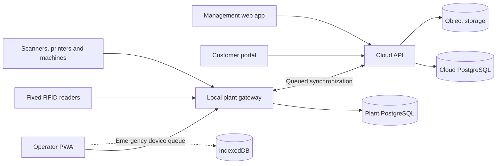

# Architecture

The Development station PWA now has a [read-only local-order view](STATION_LOCAL_ORDERS_UI.md) over the gateway's generated summary client. It does not call cloud order APIs, select/start orders or persist an additional browser order cache. The existing source authorization and opt-in endpoint boundary remain unchanged.

## Context

The product combines business administration, shop-floor workflows, and industrial device integration. Cloud availability improves coordination but must not be a prerequisite for normal plant production.

## Technology baseline

| Concern | Baseline |
|---|---|
| Management UI | Next.js, React, TypeScript |
| Operator UI | React, Vite, PWA service worker, IndexedDB |
| Cloud backend | ASP.NET Core on .NET 10 LTS |
| Edge gateway | .NET worker/service with adapter processes where required |
| Primary storage | PostgreSQL in cloud and at each plant |
| Short-lived cache | Redis only where measured need exists |
| Realtime UI | SignalR/WebSocket |
| Cloud-edge transport | HTTPS initially; MQTT 5 where its delivery model is useful |
| Files | S3-compatible storage or Azure Blob Storage |
| Identity | OpenID Connect; Microsoft Entra ID or Keycloak baseline |
| Observability | OpenTelemetry logs, metrics, and traces |
| Deployment | Containers; managed container platform before Kubernetes |
| Infrastructure | Terraform or OpenTofu |
| Testing | xUnit, Testcontainers, Playwright, simulators, resilience tests |

## Cloud application

The Development API temporarily serves a small server-rendered management bridge at `/management` (sign-in/status, order browsing and planned creation/editing). The protected order API also exposes read-only history; its page remains deferred. The bridge reuses the existing named human cookie, order access seam, and loopback HTTPS boundary. This adds no service/dependency and does not replace the Next.js management application or approve production HTML hosting. See [navigation setup](MANAGEMENT_NAVIGATION_SETUP.md) and [history setup](ORDER_HISTORY_SETUP.md).

Use a modular monolith with explicit modules:

- Identity and access
- Tenants and plants
- Customers and contracts
- Textiles and inventory
- Production
- Logistics
- Billing
- Reporting and audit
- Integrations

Modules own their domain rules and persistence mappings. Cross-module changes use explicit application contracts. Start with one API deployment and one worker deployment; extract a service only when scaling, availability, security, or independent release requirements justify it.

## Plant gateway

An explicit Development [order-read access verifier](LOCAL_ORDER_ACCESS_VERIFICATION.md) composes a temporary same-process gateway, fresh browser enrollment and transactionally audited grant/removal/revocation for that source only. It requires no cloud/identity call, suppresses forwarding, refuses an occupied listener and does not change normal startup defaults. Isolation tests and approved live verification pass: three local summaries read, temporary source/credential revoked, temporary host stopped, all pre-existing records unchanged. This is a local setup command, not persistent browser access, production human authorization or a general administration service.

The gateway also has an opt-in Development [local order-summary list API](LOCAL_ORDER_LIST_API.md). It reads only the plant database using scoped source authorization and separate `orders.read`, exposes no notes and makes no cloud/identity calls. Read-only snapshot paging is bound to local download progress; a changed revision requires restarting the list. The feature defaults off, no live station permission is granted, and operator authentication/selection UI remain separate work.

The gateway now also has [published-order storage primitives](GATEWAY_ORDER_STORAGE.md): independent current copies, atomic progress/bookmark updates and immutable payload-free batch receipts in existing plant PostgreSQL. The plant migration was applied locally on 2026-10-17. A separate [one-time Development download command](GATEWAY_ORDER_DOWNLOAD_SETUP.md) composes trusted local registration, authenticated HTTPS responses and these primitives, exiting before web-host/scan-worker startup. Approved live verification saved three matching published copies; a caught-up rerun retained those copies and advanced local progress to revision 2 with two receipts. All pre-existing plant/cloud records were verified unchanged. No automatic worker, additional service/dependency, station order endpoint or UI is added; normal gateway startup does not register the order store or initiate downloads.

See [Local gateway implementation plan](LOCAL_GATEWAY_PLAN.md) for the reviewed checkpoint sequence, scan flow, and storage tradeoffs. The host, local health checks, transactional acceptance/outbox, and Development-only forwarding worker are implemented. The gateway acquires and caches short-lived Keycloak tokens and the cloud validates their permission and tenant/plant scope (ADRs 0012–0013). The refined [station-to-gateway identity and access plan](STATION_GATEWAY_SECURITY_PLAN.md) is approved, and its first implementation slice makes trusted `https://localhost:7200` the primary Development station transport. The station PWA is built independently and bundled into the plant gateway release, which serves it from the same HTTPS origin as `/api` and `/health` ([ADR 0018](decisions/0018-gateway-hosts-station-pwa.md)). Temporary HTTP compatibility remains loopback-only until the protected scan route replaces it. Remote production access, stable plant naming, certificate provisioning, and the installation credential lifecycle remain planned.

Run a gateway on a managed industrial PC or plant server. It:

- Provides a stable local API to operator stations.
- Durably accepts scans and production events.
- Translates vendor protocols into canonical project events.
- Buffers outbound events and receives relevant configuration changes.
- Manages RFID readers, label printers, scales, and machine adapters.
- Exposes device health and synchronization diagnostics.
- Continues operating during WAN or cloud outages.

Do not expose plant equipment directly to the public internet.

Development-only synchronization diagnostics and audited replay are available through `/api/sync`, scoped to the configured tenant/plant and restricted to loopback. This is an API tool, not a supervisor UI or authenticated administration; see [ADR 0008](decisions/0008-local-sync-diagnostics-and-audited-replay.md).

## Operator application

The operator PWA is a separately built frontend bundled with the compatible plant gateway release. The gateway serves the compiled application over the same local HTTPS origin used by its API. The PWA shares design components and generated contracts with the management application and is optimized for large touch targets, scanner input, minimal typing, kiosk use, clear sound/visual feedback, and multilingual operation.

The PWA normally talks to the plant gateway over the LAN. IndexedDB is an emergency queue when even the gateway is temporarily unreachable; it is not the durable plant system of record.

## Device integration

- Keyboard-wedge barcode scanners can feed focused PWA inputs.
- Fixed RFID portals and conveyors connect to the local gateway.
- Advanced handheld RFID may require a thin native Android shell or vendor SDK adapter.
- Each vendor integration implements a project-owned adapter interface.
- Simulators must reproduce normal reads, read storms, disconnects, malformed payloads, and retries.
- The authenticated principal is the enrolled browser installation or adapter, not automatically the attached physical equipment. Keyboard-wedge input cannot reliably prove which scanner generated the keystrokes.
- Keep optional equipment inventory separate from source authentication. Add it when actual hardware requires configuration, health, maintenance, calibration, movement history, or independently verified reader identity; do not introduce a universal equipment table in checkpoint 5.4.2.

## Data ownership

Latest local activation (2026-10-17): the download-position migration is applied, with existing evidence preserved and three copies positioned 1–3. Management remains stopped, downloading remains disabled and no download permission or gateway receiver is active. The earlier implementation-status paragraphs below predate this operational activation.

The cloud now also implements an opt-in Development gateway order-download route, backed by transactional per-plant change positions and protected scope/epoch-bound bookmarks. It serves only current published copies, never superseded outbox payloads. The new migration is prepared but not locally applied, and no gateway receiver/worker is added. See [ADR 0020](decisions/0020-current-order-download-progress.md) and [download contract](ORDER_DOWNLOAD_CONTRACT.md). The earlier publication migrations, three-order initialization and management restart were activated on 2026-10-16; historical pending-activation descriptions below predate that activation.

- The gateway is authoritative for whether a local event was durably accepted while disconnected.
- The cloud is authoritative for consolidated state across plants.
- Immutable operational events synchronize; current views are projections of accepted state transitions.
- Ordinary relational tables represent current business state. Full event sourcing is not required.

Cloud planned-order writes stage filtered gateway publication heads and immutable send records in the same relational transaction as the order, audit and command receipt. The customer module supplies locked eligibility/label values, not shared persistence entities. Current access is rechecked before historical receipt return; retries do not stage historical state. The explicit Development initial-publication CLI uses bounded per-order transactions, named loopback target guards and local OS maintenance attribution rather than impersonating a signed-in operator. These earlier publication migrations and local initialization were activated on 2026-10-16. The new download-position migration remains pending and must precede starting this updated writer build. No gateway delivery worker is introduced. See [publication integration](ORDER_PUBLICATION_CONTRACT.md#automatic-staging-on-management-saves), [initial-publication setup](INITIAL_ORDER_PUBLICATION_SETUP.md) and [download contract](ORDER_DOWNLOAD_CONTRACT.md).

## Deployment environments

- Local development: containerized dependencies and device simulators.
- Development: shared cloud environment with disposable plant gateway instances.
- Staging: production-like identity, networking, migration, and synchronization tests.
- Production: managed cloud services and separately managed plant installations.

Each release must define cloud/edge compatibility. The gateway must tolerate a temporarily newer or older cloud version within the supported compatibility window.
